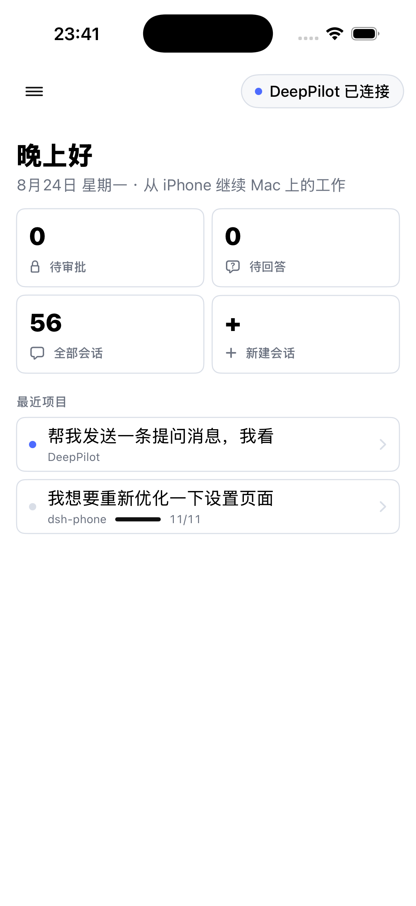
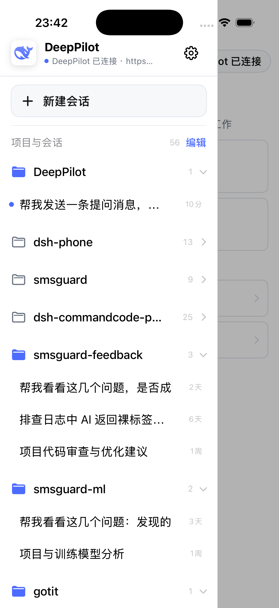
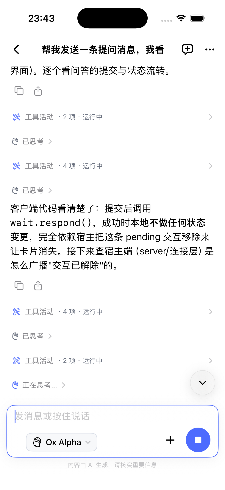
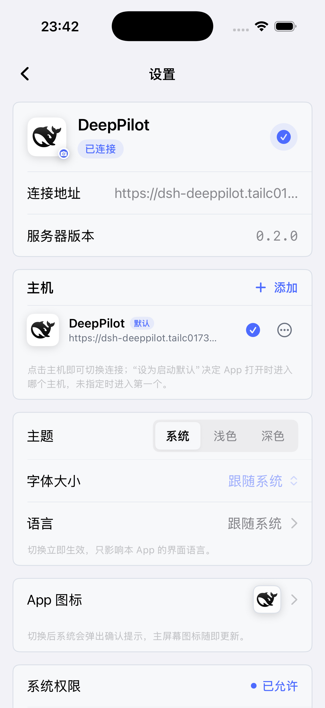

# dsh-deeppilot

**English** | [简体中文](./README.zh-CN.md)

[](https://www.npmjs.com/package/dsh-deeppilot)
[](https://github.com/deepseek-ai/deepseek-harness)
[](https://github.com/Mars-Sea/dsh-deeppilot/actions/workflows/ci.yml)
[](./LICENSE)

The open-source DSH companion plugin for **DeepPilot**, a native iPhone client
for using DeepSeek Harness remotely. It connects the app directly to the DSH
Host on your own computer and does not replace or modify the DSH Web UI.

> DeepPilot is currently in TestFlight review. The invitation link will accept
> testers after Apple approves the build.

[Join the DeepPilot TestFlight](https://testflight.apple.com/join/JHb4j5DV)

## What you get

- Browse projects, sessions, history, and live agent output from iPhone.
- Send prompts, switch models, create sessions, and answer approvals/questions.
- Pair with a five-minute single-use code and a per-device P-256 key; physical
  iPhones keep the private key in Secure Enclave.
- Connect over the LAN (TLS with a Host-issued certificate pinned during
  pairing) or the optional embedded Tailscale Funnel.
- Receive live notifications and optional APNs notifications while offline.
- Self-update hint: the settings page footer shows the installed plugin
  version, with an inline "new version" link to the matching GitHub
  release when one exists (background check, stable releases only, no
  third-party dependency).

## Install from npm

This source checkout targets Node.js 22+ and the two DSH releases it has been
audited against — `0.2.0-rc.2` (the `latest`/`next` channels) and `0.2.1-alpha.3`
(the `alpha` channel) — with a `web` profile. DSH checks a plugin's declared peer
range before composing a profile, on every start rather than only on install, so
any other host version refuses to activate this plugin. The package includes
Funnel helpers for macOS, Linux, and Windows on amd64/arm64; trusted-LAN mode
does not require the helper.

The current working tree names exactly those two versions in
`peerDependencies` and is built/typechecked against `0.2.0-rc.2`. A previously
published plugin package may still carry its own older compatibility
declaration until a release is made from this tree.

```sh
dsh plugin --profile web add dsh-deeppilot
dsh web
```

After DSH restarts, open **Settings → DeepPilot**, enable the connection, show
the pairing QR code, and scan it in the DeepPilot app. Below the QR code the same
panel shows one copyable piece of pairing info (address, single-use code and
certificate fingerprint) that can be pasted into the app in one step — useful for
Simulator or when the camera is unavailable. Switching between the LAN and
public address issues a matching new QR code and string immediately, with the
panel staying open.

LAN access is enabled by default on the plugin's independent TCP port `3098`
and is TLS-only. The plugin generates a self-signed certificate on first start
(key under `$DSH_HOME/deeppilot/lan-tls/`), and the pairing QR code carries its
public-key fingerprint so the app pins that exact Host. DSH may continue
listening only on `127.0.0.1:3080`; the plugin no longer registers any `/phone`
routes on the DSH web server. If a firewall is enabled, allow inbound TCP
`3098` on the networks you use. The port can be changed on the DeepPilot
settings page (its exact section may move between DSH versions; go by the
settings page's current layout).

Upgrading from a plugin version that served plain `ws://` on the LAN: devices
paired over the LAN must pair again so they receive the certificate
fingerprint. Devices paired through Funnel are unaffected.

Package: [npmjs.com/package/dsh-deeppilot](https://www.npmjs.com/package/dsh-deeppilot)

## Update or uninstall

```sh
dsh plugin --profile web update dsh-deeppilot
dsh plugin --profile web remove dsh-deeppilot
```

Restart DSH after updating. Uninstalling the package does not delete the local
DeepPilot state under `$DSH_HOME/deeppilot/`.

## Publishing (maintainers)

采用可信发布（Trusted Publishing）：GitHub Actions（GitHub 工作流）通过 OIDC
身份认证发布，并生成来源证明（Provenance），无需长期 npm 发布令牌。

1. 同步包版本与锁文件版本，按 `AGENTS.md` 完成发布验证；提交、推送并等待
   持续集成（CI）通过。
2. 从已合入 `main` 的发布提交创建附注标签 `v<版本>`，准备英文与简体中文的
   GitHub Release（发布页）草稿。
3. 经用户授权后，在该版本标签上手动运行 `publish.yml`。稳定版使用
   `latest`（稳定分发标签），预发布版使用 `alpha`（预发布分发标签）。
4. 核对 npm 版本、分发标签、包完整性与来源证明，并在全新 DSH 配置中安装验证，
   然后公开 GitHub 发布草稿。

工作流不会因推送标签自动发布。npm 网站绑定、手动命令及首次发布的验证边界见
[npm 可信发布说明](./docs/NPM_PUBLISHING.md)。


## Connection and privacy

Conversation traffic travels directly between the iPhone and your DSH Host and
is always encrypted: the LAN listener on port `3098` serves TLS with a
self-signed certificate whose fingerprint the app receives during pairing, and
Funnel mode uses Tailscale-issued certificates. The app refuses plain `ws://`.
Both the LAN listener and optional Funnel mode expose only the DeepPilot
connection, one-time pairing, and health endpoints, not the complete DSH Web UI.

The DeepPilot settings page exposes **Connections per public source**. It
defaults to `8`, accepts `1`–`16`, and briefly restarts the Funnel helper when
changed, so connected remote clients reconnect once (its exact section may
move between DSH versions; go by the settings page's current layout). The
device list also supports a custom name for each paired device. Names are
stored in the host registry and survive iPhone reconnects or changes to the
system-reported name; saving an empty value restores the iPhone-reported
default.

The settings page's **Testing & troubleshooting** group has a `debug` toggle.
Turning it on prints handshake and push diagnostics to the DSH host's terminal
output (for example, the actual capability bits sent in `s2c.welcome`); it
never prints pairing tokens, APNs tokens, or message content, and takes effect
immediately without restarting DSH.

Offline push is optional. Relay mode sends only the target APNs device token
and a limited notification payload; full conversation history and live output
do not pass through the relay. Read [PRIVACY.md](./PRIVACY.md) and
[SECURITY.md](./SECURITY.md) before enabling remote access or push. Protocol-v2
implementation status and remaining release validation are tracked in
[docs/SECURITY_ROADMAP.md](./docs/SECURITY_ROADMAP.md).

## Screenshots

| Home | Sidebar | Chat | Settings |
| --- | --- | --- | --- |
|  |  |  |  |

## Compatibility

See [COMPATIBILITY.md](./COMPATIBILITY.md) for the tested baseline and current
limitations. DSH is still evolving; include exact DSH and plugin versions when
reporting an issue.

## Protocol

[PROTOCOL.md](./PROTOCOL.md) is the normative DeepPilot bridge protocol. Any
wire change must update that document and `src/protocol.ts` together and be
coordinated with the private iOS client. Protocol v2 is the only supported wire
version; upgrades from v1 require re-pairing.

## Development

```sh
npm ci
npm test
npm run typecheck
npm run build
cd helper && go test ./...
```

## Community and feedback

- [GitHub Issues](https://github.com/Mars-Sea/dsh-deeppilot/issues)
- [GitHub Releases](https://github.com/Mars-Sea/dsh-deeppilot/releases)
- [npm package](https://www.npmjs.com/package/dsh-deeppilot)
- [Linux.do 社区](https://linux.do/)

DeepPilot is an independent community project and is not affiliated with or
endorsed by DeepSeek.

## License

MIT — see [LICENSE](./LICENSE).
