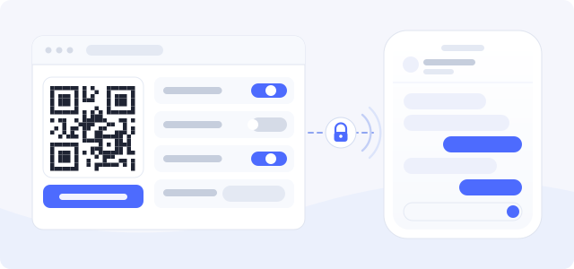

DeepPilot connects an iPhone directly to DeepSeek Harness on this computer. The plugin adds
a settings page, a single-use pairing QR code, and an encrypted connection channel to DSH.
It does not replace or modify the DSH Web UI.

## Pair a phone

1. Open **Settings → DeepPilot** and turn on "Allow phone connections".
2. Click "Add phone" beside "Paired devices", then scan the code with the DeepPilot app.
   Without a camera, copy the pairing details from the panel and paste them into the app once.
3. On the same Wi-Fi the phone uses the LAN automatically; away from home it switches to the
   public route without pairing again.

A pairing code is valid for five minutes and works once. Each iPhone uses its own P-256 key,
and a physical iPhone keeps the private key in the Secure Enclave.

## Switches on the settings page

| Switch | Default | Effect |
| --- | --- | --- |
| Allow phone connections | Off | Master switch; when off, no phone can connect |
| Remote connection | Off | Embedded Tailscale Funnel, so the phone connects from outside the LAN |
| Local web preview | On | Opens local web pages mentioned in a session inside the app |
| Let the phone open the desktop web UI | Off | Opens this computer's DSH Web UI, including third-party plugin pages |

The LAN listener is always on, uses its own port (`3098` by default), and serves TLS only.
The port is configurable on the settings page.

## Privacy

Session traffic goes from the iPhone straight to this computer and never through a third-party
server. The LAN listener uses a certificate the plugin issues itself; its fingerprint reaches
the app during pairing, and the app refuses plaintext connections. Offline push is optional:
the relay carries only the device token and limited notification content, never full session
history.

## Known limitation

DSH enables HMR (hot reload) by default. Updating the plugin from inside the app makes the Host
roll the update back because of a directory-picker composition conflict: the plugin stays intact
and the installed version is unchanged. To update in place, turn HMR off first, or update while
DSH is stopped.

## More

- [GitHub repository](https://github.com/Mars-Sea/dsh-deeppilot)
- [npm package](https://www.npmjs.com/package/dsh-deeppilot)
- [Privacy](https://github.com/Mars-Sea/dsh-deeppilot/blob/main/PRIVACY.md)
- [Security](https://github.com/Mars-Sea/dsh-deeppilot/blob/main/SECURITY.md)
