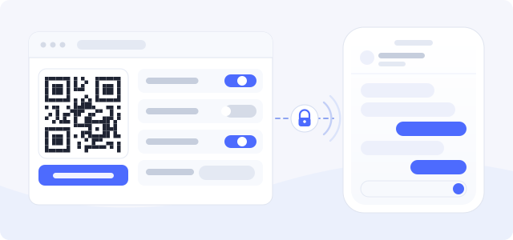

DeepPilot 让 iPhone 直接连接这台电脑上的 DeepSeek Harness。插件在 DSH 里提供设置页、
一次性配对二维码和一条加密连接通道；它不替换也不修改 DSH 网页端。

## 配对手机

1. 打开 **设置 → DeepPilot**，开启「允许手机连接」。
2. 在「已配对设备」右侧点击「添加手机」，用 DeepPilot App 扫码。
   相机不可用时，复制面板里的「配对信息」在 App 中粘贴一次即可。
3. 同一 Wi-Fi 下手机自动走局域网；在外自动改走公网，不需要重新配对。

配对码 5 分钟内有效且只能用一次。每台 iPhone 使用自己的 P-256 密钥，真机私钥保存在
Secure Enclave。

## 设置页的开关

| 开关 | 默认 | 作用 |
| --- | --- | --- |
| 允许手机连接 | 关闭 | 总开关；关闭后不接受任何手机连接 |
| 远程连接 | 关闭 | 内嵌 Tailscale Funnel，让手机在外网也能连 |
| 本机网页预览 | 开启 | 在 App 内打开会话里出现过的本机网页 |
| 允许手机打开电脑端网页 | 关闭 | 在 App 内打开这台电脑的 DSH 网页端，含第三方插件页面 |

局域网连接始终开启，使用独立端口（默认 `3098`），只提供 TLS。端口可在设置页修改。

## 隐私

会话流量由 iPhone 直接连到这台电脑，不经过第三方服务器。局域网使用插件自签证书，
指纹在配对时下发给 App，App 拒绝明文连接。离线推送是可选项：中继只发送设备 Token
和有限的通知内容，完整会话历史不会经过中继。

## 已知限制

DSH 默认启用 HMR（热重载）。在 App 里在线更新插件时，宿主会因目录选择后端的组合
冲突回滚这次更新：插件不会损坏，已安装版本保持不变。需要在线更新时请先关闭 HMR，
或在 DSH 停止时更新。

## 更多

- [GitHub 仓库](https://github.com/Mars-Sea/dsh-deeppilot)
- [npm 包](https://www.npmjs.com/package/dsh-deeppilot)
- [隐私说明](https://github.com/Mars-Sea/dsh-deeppilot/blob/main/PRIVACY.md)
- [安全说明](https://github.com/Mars-Sea/dsh-deeppilot/blob/main/SECURITY.md)
